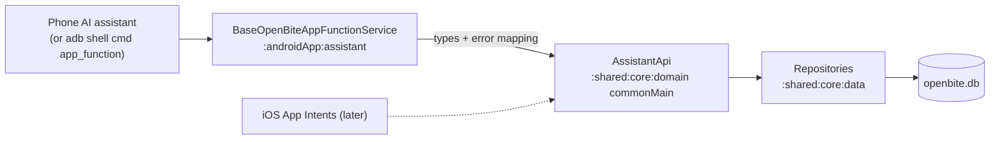

# Design: Phone AI assistant (AppFunctions)

## Why AppFunctions instead of an MCP server

The first plan was a desktop server with an MCP endpoint. It was dropped because users would have to install and run a server. AppFunctions lets the phone's own assistant call into the installed app, so "install the APK and it works" stays true.

## Layers

- `@AppFunctionServiceEntryPoint` abstract class `BaseOpenBiteAppFunctionService`; KSP generates `OpenBiteAppFunctionService` and `assets/openbite_app_function_service.xml`.
- Function id: `com.openbite.android.assistant.BaseOpenBiteAppFunctionService#<name>`.
- App instructions live in `res/xml/app_metadata.xml` (`appfn:instructions`).
- Dependencies come from Koin with `by inject()`.

## Limits

All limits are constants in `AssistantApi.kt` and are the single source for validation and docs:

| Constant | Value |
| --- | --- |
| `ASSISTANT_MAX_LOGS` / `ASSISTANT_MAX_PLACES` | 50 / 50 |
| `ASSISTANT_MAX_DISHES` | 300 |
| `ASSISTANT_MAX_ITEMS` / `ASSISTANT_MAX_QTY` | 30 / 20 |
| `ASSISTANT_MAX_NOTE` | 500 |
| `ASSISTANT_DEFAULT_DAYS` / `ASSISTANT_MAX_DAYS` | 30 / 366 |
| `ASSISTANT_DEFAULT_RADIUS_KM` / `ASSISTANT_MAX_RADIUS_KM` | 2 / 50 |

## Errors

`AssistantException(AssistantErrorKind)` in shared code. A pure mapping function in `:androidApp:assistant` turns it into `AppFunctionInvalidArgumentException` or `AppFunctionElementNotFoundException`; anything else becomes a generic error and is logged.

## Distance

`searchPlaces` filters with a lat/lon bounding box in SQL, then sorts by great-circle distance (`distanceKm`) in Kotlin. Personal data is small, so no spatial index is needed.

## Who can call it

Gemini's AppFunctions integration is still a trusted-tester preview, so development and the demo use `adb shell cmd app_function`, which runs the same code path an assistant would.

## Testing

- `AssistantApi`: earlier meals capped at 5 and before the next occurrence, blank `milestoneId`, draft and `createdBy` marks, note newlines, every out-of-range input.
- Error mapping and field mapping are pure functions with unit tests.
- Snapshot test of the generated XML: function ids and required parameters, so a rename can't slip through.
