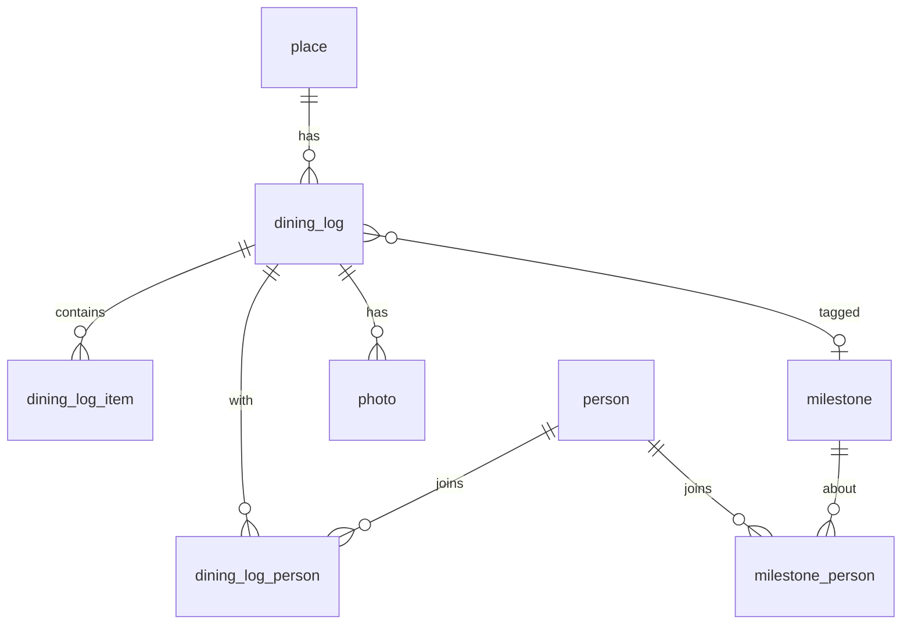

# Design: Dining memory and milestones

## Data

Room KMP, schema v3 (`shared/core/database/schemas/`). The tables used here:

- v2 added a per-meal total score, the original-language dish name snapshot and `photo.kind` (`meal` / `receipt`).
- v3 added `place.countryCode` for currency inference.

## Components

| Component | Module | Job |
| --- | --- | --- |
| `PlaceOrderUseCase` | domain | creates the draft (and new place) and schedules the 90-minute follow-up |
| `SaveMealUseCase`, `AddMealPhotoUseCase`, `DiscardPhotosUseCase` | domain | edit flow; discarded photos are deleted in the app scope |
| `ReadReceiptUseCase`, `SaveReceiptUseCase` | domain | receipt via the active vision model |
| `nextOccurrence`, `upcomingMilestones` | domain (`Milestones.kt`) | pure date maths, Feb 29 rule, local dates |
| `MilestoneRemindersUseCase` | domain | due window, on/off switch, once per year via sent keys in DataStore |
| `ReminderScheduler` | interface in data, WorkManager impl in app | two notification channels: meal follow-up and milestone |
| `DeletePlaceUseCase` + `PlaceRemovalRepository` | domain / data | child-to-parent delete in one transaction, then file cleanup |

## Decisions

- **Draft first, details later.** The only required input is the order itself; everything else is optional and nudged by notification.
- **Daily WorkManager check for milestones** instead of exact alarms: no exact-alarm permission, survives reboots, and a day of precision is enough.
- **Sent keys, not flags.** `milestoneReminderKey` includes the occurrence year, so a yearly milestone reminds again next year without cleanup.
- **Local date matching.** Stored next to UTC millis and the IANA zone, so anniversaries don't drift when travelling.

## Testing

- Milestones: future one-off, Feb 29 in leap and non-leap years, first occurrence in the future, `daysAhead` boundaries.
- Reminder window, switch and once-per-year rule.
- Migration test compares all tables' columns, indexes and foreign keys for v1 -> v2 -> v3.
- Meal edit ViewModel: photos added during save, dirty state, save failure.
- Delete place: SQL test of what is removed and kept, plus ViewModel confirmation flow.
