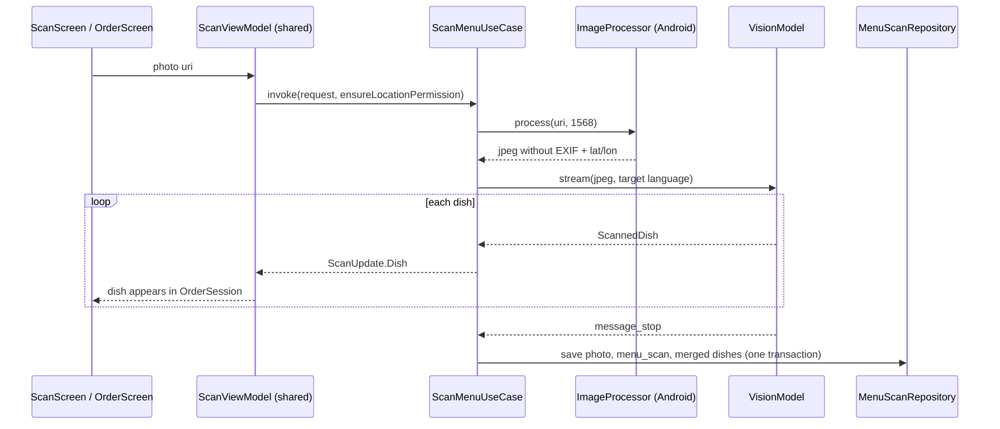

# Design: Menu scan and order

## Flow

## Components

| Component | Module | Job |
| --- | --- | --- |
| `ImageProcessor` | interface in `:shared:core:data`, impl in `:androidApp:app` | read GPS, strip EXIF via re-encode, resize |
| `LocationProvider` | same | one fix via `LocationManagerCompat.getCurrentLocation` (no Play services) |
| `VisionModel` | `:shared:core:network` | thin interface: image + language -> `Flow<ScannedDish>` |
| `ClaudeVisionModel`, `OpenAiCompatVisionModel` | `:shared:core:network` | the two wire formats over Ktor SSE |
| `SampleVisionModel` | `:shared:core:network` | demo mode, offline |
| `ActiveVisionModel` | `:shared:core:domain` | resolves provider, model, key and demo mode for each call |
| `ScanMenuUseCase` | `:shared:core:domain` | orchestrates; nothing is saved if the stream fails |
| `MenuMerge` | `:shared:core:domain` | merges a new scan into an existing place menu |
| `OrderSessionRepository` | `:shared:core:data` | in-memory sessions so order and ticket screens share state |
| `PhraseTables`, `ReceiptLanguages` | `:shared:core:domain` | built-in ticket sentences for 13 languages |

## Decisions

- **Two wire formats, not one SDK per vendor.** Gemini and DeepSeek offer OpenAI-compatible endpoints, so five providers need only two clients.
- **Vision check by probe.** Providers don't say which models accept images, so a 64x64 red PNG decides it once per model.
- **Session in the data layer.** Retry is a command sent from the order screen to the scan ViewModel, so the order screen never owns the network call.
- **Whole-or-nothing save.** A truncated stream would create a menu with missing dishes and wrong totals, so it is a failure.

## Error handling

`ScanException(ScanError)` covers: no model, bad key, model retired, image unreadable, place missing, network, truncated stream. Each maps to one message and, where it helps, a button to the provider page.

## Testing

- Network: SSE parser tests for both formats, including missing `message_stop` and `max_tokens`.
- Domain: menu merge (trim, lower-case currency, negative price), currency inference order, phrase-table completeness and AI-table JSON validation.
- ViewModel: sample scan fills the session, location permission path, retry command, raw file cleanup on retake and exit.
