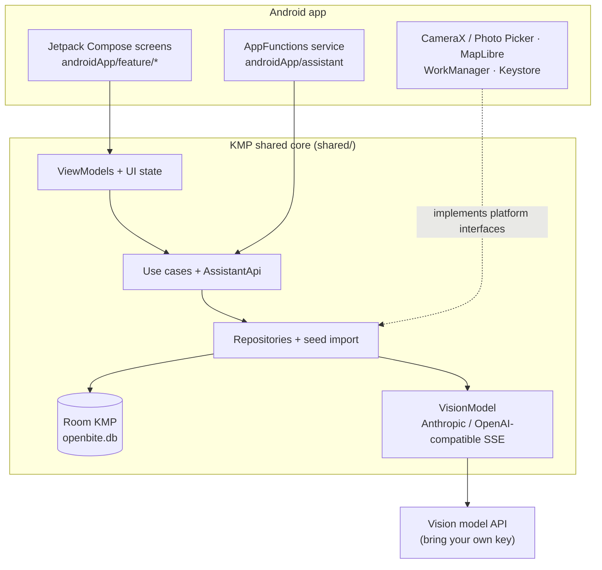

# OpenBite 🍜👻

**Snap a menu you can't read, order from it, and your phone remembers the meal for next year.**

OpenBite is an Android app built for [Kiroween 2026](https://kiroween.devpost.com/) in the **Frankenstein** category. It stitches four parts that were never meant to fit into one loop, each feeding the next:

```text
vision LLM (order)  ->  local Room database (memory)  ->  native map (place)  ->  Android AppFunctions (recall)
```

No server, no account, no cloud. Install the APK and it works.

> Demo video: _coming soon_ · Category: Frankenstein · License: MIT

## What it does

The user does two things: take a photo and pick dishes. Everything else is generated.

1. **Scan.** Take or pick a menu photo. OpenBite reads the photo's GPS as the place location, then strips all EXIF before upload.
2. **Read.** The vision model you chose streams a structured, translated menu. Dishes appear one by one, with possible allergens.
3. **Order.** Pick dishes and portions. A full-screen ticket shows the staff your order and allergies in the menu's own language.
4. **Remember.** Tapping "Ordered" creates a draft dining log with dishes, prices, time and place filled in.
5. **Fill in.** 90 minutes later a notification asks for a rating, a short note and photos. You can also archive the receipt.
6. **Map.** Every place becomes a pin with a "time capsule" of meals you had there.
7. **Recall.** 7 days before an anniversary the app reminds you. Your phone AI assistant can read past meals through AppFunctions and suggest where to go.

Also: milestone management, search, share a meal as an image, share a place as an `.openbite` file, Chinese and English UI, locale-aware money and dates.

## Try it (for judges)

**You don't need an API key.** On first launch the app imports a Kyoto sample story: 5 places, 45 dishes, 8 meals, 3 milestones and 2 people.

1. Download `OpenBite.apk` from the [Releases](../../releases) page and install it on an Android 8.0+ phone (arm64).
2. Open the app. The **Today** tab shows the next milestone and recent meals.
3. To scan without a key, open **Settings** and turn on **Demo mode**. Scans then use bundled sample menus and stay offline.
4. To scan real menus, open **Settings -> AI providers**, add a key for Anthropic, OpenAI, Google Gemini, DeepSeek or any OpenAI-compatible endpoint, then pick a model. The model list is fetched from the provider.
5. Switch the app to English with the phone's per-app language setting, or **Settings -> Language**.

### Call the assistant functions (Android 16+)

AppFunctions is how the phone's AI assistant talks to OpenBite. You can call the same functions from a computer with `adb`:

```bash
adb shell cmd app_function list-app-functions | grep -A3 com.openbite.android

adb shell cmd app_function execute-app-function \
  --package com.openbite.android \
  --function 'com.openbite.android.assistant.BaseOpenBiteAppFunctionService#upcomingMilestones' \
  --parameters '{"daysAhead":30}'
```

Use `com.openbite.android.debug` as the package for a debug build.

| Function | What it returns or does |
| --- | --- |
| `upcomingMilestones` | milestones in the next N days, with up to 5 earlier meals for each |
| `queryDiningLogs` | meals filtered by milestone, person or date range |
| `searchPlaces` | places by tags, sorted by distance when a location is given |
| `getPlaceMenu` | a place's menu with how often each dish was ordered and its average rating |
| `createDiningLog` | creates a **draft** meal marked "assistant log" |

Four functions are read-only and one is append-only. The assistant can't edit or delete anything, and never sees photos, receipts, file paths or API keys.

## Privacy

- All data lives in one SQLite file on the phone. It is excluded from cloud backup and device transfer.
- The only data that leaves the phone is an EXIF-stripped menu or receipt photo, sent to the provider **you** chose.
- API keys are encrypted with the Android Keystore and never written to the database, logs or exports.
- Allergen information is marked "for reference only, please confirm with staff".

## Architecture

Kotlin Multiplatform core with native UI, the shape Google recommends for KMP. Android ships now; an iOS SwiftUI app can reuse the same shared modules later.



| Part | Choice |
| --- | --- |
| Language | Kotlin 2.4.21, KMP |
| UI | Jetpack Compose, Material 3, Navigation 3 |
| Database | Room 2.8.5 (KMP), schema v3 with tested migrations |
| DI | Koin 4.2.2 |
| Network | Ktor 3.6.1, server-sent events |
| Map | MapLibre Native 13.7.1 + OpenFreeMap (no key) |
| Assistant | `androidx.appfunctions` 1.0.0-rc01 |
| Build | Gradle 9.8.2, AGP 9.5.0, JDK 21 |

Dependencies flow one way: `feature -> domain -> data -> database / network / model`. A convention plugin fails the build if a shared feature module reaches past the domain layer.

## Build from source

Requirements: JDK 21, Android SDK with platform 37, Gradle 9.8.2 (the wrapper points to it).

```bash
./gradlew :androidApp:app:assembleDebug     # debug APK, all ABIs
./gradlew :androidApp:app:installDebug      # install on a connected phone
./gradlew test                              # all JVM unit tests (261 tests)
./gradlew :androidApp:app:assembleRelease   # release APK: R8, arm64-v8a only, ~16 MB
```

A release build is signed with your own key when these four values are set as environment variables or in `local.properties` (which is not committed): `RELEASE_STORE_FILE`, `RELEASE_STORE_PASSWORD`, `RELEASE_KEY_ALIAS`, `RELEASE_KEY_PASSWORD`. Without them Gradle signs with the debug key and prints a warning.

## Project layout

```text
shared/core/{model,database,network,data,domain,testing}   KMP core
shared/feature/*                                           shared ViewModels
androidApp/app                                             app shell, Koin, Navigation 3, platform code
androidApp/core/designsystem                               theme and shared components
androidApp/feature/*                                       Compose screens
androidApp/assistant                                       AppFunctions
tools/seed/draw_menus.py                                   draws the sample menu photos
docs/                                                      plan and HTML design mocks
.kiro/                                                     steering, specs and hooks
```

## How Kiro was used

OpenBite was built with **Kiro Crew**: one main agent that planned and reviewed, plus background subagents that implemented and verified each step.

- **Plan and design first.** The product plan and 19 HTML design mocks in `docs/` were written with Kiro and approved before any screen was coded. The plan was later cut from "desktop server + MCP + web app" to "phone only" when the server proved too hard for users to install.
- **Step-by-step subagents.** The UI was split into six steps (U1-U6), then features F1-F8. Each step went to a subagent with one rule: `assembleDebug` and tests must pass, then one commit prefixed with the step id. `git log` shows the trail.
- **Parallel review.** Five read-only subagents reviewed architecture, Navigation 3, edge-to-edge/Compose, data/security and AppFunctions/tests at the same time. Their findings became 39 fix commits (R1-R3), tests grew from 142 to 209, and four real bugs were found.
- **On-device verification.** A subagent drove the phone over `adb`, checked each screen and all five AppFunctions, and found the map camera race fixed in F4.
- **Specs** (`.kiro/specs/`): requirements in EARS form, design and tasks for the four parts of the loop. Every finished task links to the commit that delivered it; open tasks are what's left before the freeze.
- **Steering** (`.kiro/steering/`): product, tech and structure rules always loaded, plus file-matched rules for Room data, the assistant boundary and Android UI. Example: "never hardcode model names" came from a correction during development and now lives in `tech.md`.
- **Hooks** (`.kiro/hooks/`): a pre-write guard that blocks API keys and signing passwords (the repo is public), a layer check for shared ViewModels, review prompts for Room schema changes, missing English strings and assistant-boundary changes, and unit tests after each spec task.
- **Android skills.** The official [android/skills](https://github.com/android/skills) were installed into Kiro Crew and used for Navigation 3, edge-to-edge, AppFunctions and AGP 9.

## Roadmap

- iOS app with SwiftUI and App Intents on the same shared core
- Gemini AppFunctions integration when it leaves preview
- On-device vision model
- End-to-end encrypted backup
- Year-in-review

## Credits

- Sample menu photos are drawn by `tools/seed/draw_menus.py`; no third-party images are used.
- Map tiles: [OpenFreeMap](https://openfreemap.org/), data © [OpenStreetMap](https://www.openstreetmap.org/copyright) contributors.

## License

[MIT](LICENSE)
