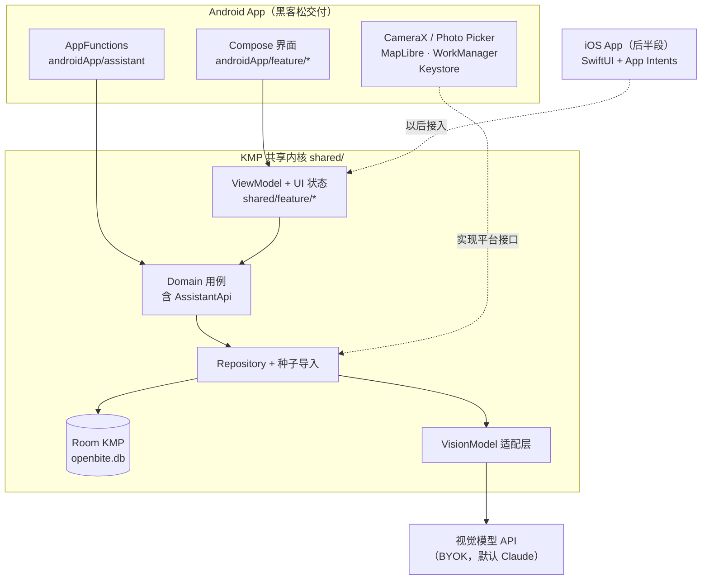
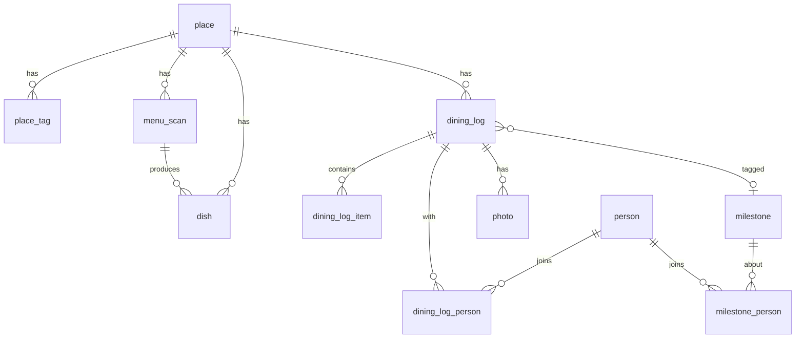

# OpenBite 黑客松落地计划

Nov 11, 2026 · @Changle（11/17 改为纯手机端；黑客松期间只做 Android）

## 定位与叙事

主攻 **Best Frankenstein**：把视觉大模型、原生地图、手机本地数据库和系统级 AI 助手接口缝成一个“点一次菜，就留下一段记忆”的个人生活外脑。

- **一句话：** 拍一张看不懂的菜单，点完菜就自动生成一段手机 AI 助手能回忆的用餐记忆。
- **缝合逻辑：** 点单（视觉模型）→ 记忆（本地数据库）→ 空间（原生地图）→ 回忆（AppFunctions + 系统助手）。每一块的输出都是下一块的输入。
- **装上就能用：** 没有电脑端服务，没有账号，没有云端数据库。装上 APK 即可使用。
- **为 iOS 留好路：** 业务逻辑写在 Kotlin Multiplatform（KMP）共享模块里。黑客松只交 Android；iOS 用 SwiftUI 接同一份共享代码，放在后半段。
- **诚实的隐私表述：** 数据全部存在手机本地。识别菜单时，图片会发给用户自选的模型（BYOK），上传前剥离 EXIF。系统助手读取数据后如何处理，取决于助手本身，这一点在 App 内说明。
- **砍掉的叙事：** 连锁店小程序截图降级为“导入历史记录”，进 Roadmap。

## MVP 范围

只做一条能在 3 分钟内演完的主线，其余全部进 Roadmap。

| 功能 | 决定 | 理由 |
| --- | --- | --- |
| 纸质 / 手写菜单拍照识别 + 翻译 | 做 | Demo 的“视觉奇迹”，痛点最直观 |
| 外卖式点单界面（分类、加减份数、备注） | 做 | 识别结果的承载界面 |
| “给店员看”全屏小票（原文 + 忌口） | 做 | 点单闭环的终点，带“仅供参考”提示 |
| 点单后自动生成用餐记录草稿 | 做 | 解决录入成本，连接点单与记忆 |
| 打分、短评、照片、纪念日标签 | 做 | 记忆的最小内容 |
| 地图打点（照片 GPS / 当前定位 / 手动） | 做 | 空间维度，Demo 镜头好看 |
| 纪念日实体 + 本地通知提醒 | 做 | 助手环节的数据来源 |
| AppFunctions（5 个函数） | 做，排在主线之后 | 助手联动；主线做完再接 |
| 申请 Gemini AppFunctions 测试资格 | 暂不 | 后面再说 |
| iOS SwiftUI 界面 + App Intents | 后半段 | 黑客松期间不做；共享模块已预留 iOS 目标 |
| 电脑端服务 / Bun / MCP Server | 删除 | 部署麻烦，用户装不上 |
| 云同步 / 账号 | 不做 | 与“装上就能用”冲突 |
| 小程序长截图导入、菜名 TTS、年度回顾、逆地理编码、端侧视觉模型 | 不做 | 进 Roadmap |

## 核心闭环

用户只主动做两件事：拍照和点菜。记录、打点、提醒都由 App 顺势生成。

1. **拍照：** 调起系统相机或相册。先读出照片里的经纬度作为店铺位置候选，没有就取一次当前定位。然后重新编码图片，去掉全部 EXIF。
2. **识别：** 视觉模型流式返回结构化菜单（分类、原文名、译名、价格、可能的过敏原），菜品逐条出现。
3. **点单：** 用户勾选菜品、填写忌口，生成“给店员看”的全屏小票。
4. **自动记录：** 点“已下单”即创建一条用餐记录草稿，菜品、价格、时间、时区、位置全部预填。
5. **补记忆：** 下单 90 分钟后发一条本地通知，用户补打分、短评、照片，可选纪念日标签与同行人。
6. **地图：** 店铺以图钉出现在地图上，点开看历次记录。
7. **回忆：** 纪念日前 7 天发本地通知。AI 助手通过 AppFunctions 读取去年的记录并给出建议。

## 技术架构

### 总体思路

按 Google 推荐的方式做：**KMP 共享业务逻辑，界面各自原生**。Room、DataStore、ViewModel 等 Jetpack 库都支持 KMP，所以 Android 按 MAD 写的数据层和 ViewModel，以后 iOS 可以直接用。

| 层 | 共享 / 原生 | 放什么 |
| --- | --- | --- |
| 界面 | 原生 | Android：Jetpack Compose（现在）；iOS：SwiftUI（后半段） |
| 系统接口 | 原生（薄） | 相机、定位、地图、通知、AppFunctions、密钥存储 |
| 展示逻辑 | 共享 | 各页面的 ViewModel 与 UI 状态 |
| 领域逻辑 | 共享 | 用例：识别菜单、下单生成草稿、计算纪念日、助手查询 |
| 数据 | 共享 | Repository、Room 数据库、视觉模型适配层、种子数据导入 |

### 架构图



唯一离开手机的数据是去掉 EXIF 的菜单图片，以及用户主动让系统助手读取的那部分记录。

### 模块划分（MAD 模块化）

依赖方向：`feature` → `domain` → `data` → `database` / `network` / `model`。feature 之间互不依赖，跳转由 `:androidApp:app` 负责。每个阶段只加当阶段要用的模块。

```text
Hackathon-kiroween/
├── build-logic/convention/          # 约定插件：openbite.kmp.library / android.application / android.feature
├── gradle/libs.versions.toml        # 版本目录
├── shared/                          # KMP 共享内核（现在只编 Android 目标）
│   ├── core/model/                  # 纯数据类（@Serializable）            ✅ 已建
│   ├── core/database/               # Room：11 张表、DAO、Schema 导出       ✅ 已建
│   ├── core/network/                # VisionModel 接口（Claude 实现 11/19）  ✅ 已建接口
│   ├── core/data/                   # Repository、种子导入、平台接口        ✅ 已建
│   ├── core/domain/                 # 用例、纪念日计算（含单元测试）         ✅ 已建
│   └── feature/journal/             # 记录页 ViewModel                     ✅ 已建
│       （scan / order / map / milestone / settings 按阶段加）
├── androidApp/
│   ├── app/                         # Application、Koin 装配、种子 JSON       ✅ 已建
│   ├── core/designsystem/           # Compose 主题                          ✅ 已建
│   ├── feature/journal/             # 记录页 Compose                        ✅ 已建
│   │   （scan / order / map / milestone / settings 按阶段加）
│   └── assistant/                   # AppFunctions，只调 AssistantApi       主线之后
├── iosApp/                          # 后半段
└── .kiro/                           # specs、steering、hooks
```

`gradle.properties` 里的 `openbite.ios=false` 控制共享模块是否编译 iOS 目标。做 iOS 时改成 `true`，再建 Xcode 工程。

### 平台接口

平台能力在 `shared/core/data/.../platform/PlatformServices.kt` 里定义成接口，Android 在 `:androidApp:app` 实现，用 Koin 注入。

| 接口 | 作用 | Android 实现 | 状态 |
| --- | --- | --- | --- |
| `SeedSource` | 读种子数据 JSON | 读 `assets/seed/seed.json` | ✅ 已实现 |
| `ImageProcessor` | 读 GPS、去 EXIF、压缩到 1568px 长边 | `ExifInterface` + 重新编码 JPEG | 11/19 |
| `LocationProvider` | 取一次当前定位 | Fused Location | 11/19 |
| `SecretStore` | 存 API Key | Keystore 加密后存 DataStore | 11/19 |
| `ReminderScheduler` | 饭后提醒、纪念日提醒 | WorkManager + 通知 | 11/23 |
| `PhotoStore` | 保存照片，返回相对路径 | `filesDir/photos/` | 11/23 |

### 构建环境与技术栈

版本全部取自本机已有的 Gradle 和缓存，不额外下载 Gradle 发行版。

| 项 | 版本 / 选型 |
| --- | --- |
| Gradle | 9.8.2（本机已有，Wrapper 指向它） |
| JDK | 21（Gradle 工具链） |
| AGP | 9.5.0（自带 Kotlin 编译，不再用 kotlin-android 插件） |
| Kotlin / KSP | 2.4.21 / 2.3.13 |
| SDK | minSdk 26，targetSdk 36，compileSdk 37（AppFunctions 的要求） |
| 数据库 | Room 2.8.5（KMP）；Android 用系统 SQLite，iOS 以后用 BundledSQLiteDriver |
| 依赖注入 | Koin 4.2.2 |
| 界面 | Compose BOM 2026.06.01 + Material 3 |
| 共享 ViewModel | `org.jetbrains.androidx.lifecycle:lifecycle-viewmodel` 2.11.0 |
| 时间 / 序列化 | kotlinx-datetime 0.8.0 / kotlinx.serialization 1.9.0 |
| 网络（11/19 加） | Ktor 3.6.1 |
| 地图（11/25 加） | MapLibre Native，不需要付费 Key |
| 助手接口（主线后加） | `androidx.appfunctions` 1.0.0-beta01 起 |

常用命令：

```bash
./gradlew :androidApp:app:assembleDebug   # 打 debug APK
./gradlew :androidApp:app:installDebug    # 装到连着的手机
./gradlew test                            # 跑全部 JVM 单元测试
```

**视觉模型：** `VisionModel` 接口很薄：输入图片和目标语言，输出菜品流。默认接 Claude：开发测试用 Haiku 5.5 控制成本，效果不够再切 Sonnet 5.5。11/20 用测试集各跑一遍，按识别准确率定默认值。

**评委不需要 API Key：** 首次启动导入种子数据（预先识别好的菜单 + 记录）。不填 Key 也能体验点单、记录、地图和助手调用。只有“现场拍新菜单”需要用户自带 Key。

## 数据模型

所有数据在一个 Room 数据库文件里（`openbite.db`）。实体代码在 `shared/core/database/src/commonMain/kotlin/com/openbite/core/database/entity/Entities.kt`，导出的 Schema 在 `shared/core/database/schemas/`。

### 设计约定

- **主键：** UUID 字符串，不依赖自增。
- **价格：** 存最小货币单位的整数（`priceMinor`，1280 日元存 1280，12.50 美元存 1250），不用浮点数。
- **时间：** 存 UTC 毫秒 + IANA 时区（`Asia/Tokyo`）+ 当地日期（`2025-11-27`）。纪念日按当地日期匹配，不受换时区影响。
- **列表字段：** 要查询的（同行人、标签）用关联表；只展示的（过敏原）存 JSON 字符串。
- **照片：** 文件存 App 私有目录，数据库只存**相对路径**。以后上 iOS 时，沙盒绝对路径每次更新会变。
- **快照：** 记录里的菜名和价格存快照，菜单被重新识别也不影响历史记录。
- **外键：** 删店铺级联删标签、菜单、记录；删菜品时记录里的 `dishId` 置空，快照保留。
- **迁移：** `exportSchema = true`，Schema JSON 提交进仓库；改表就升版本并写 Migration，不做破坏性重建。

### 表结构



| 表 | 主要字段 | 说明 |
| --- | --- | --- |
| `place` | `id`, `name`, `lat`, `lon`, `address` | 经纬度有索引，附近查询先框选再精算 |
| `place_tag` | `placeId`, `tag` | “深夜食堂”“适合约会” |
| `menu_scan` | `placeId`, `photoPath`, `model`, `rawJson` | 一次识别；存原始输出便于重放 |
| `dish` | `placeId`, `scanId`, `nameOriginal`, `nameTranslated`, `priceMinor`, `currency`, `allergensJson` | 过敏原界面标“仅供参考” |
| `dining_log` | `placeId`, `visitedAt`, `timezone`, `localDate`, `status`, `milestoneId`, `createdBy` | `status`：draft / done；`createdBy`：user / assistant |
| `dining_log_item` | `logId`, `dishId`, `nameSnapshot`, `priceMinorSnapshot`, `qty`, `rating`, `comment` | 评分 1–5 |
| `dining_log_person` | `logId`, `personId` | 同行人 |
| `photo` | `logId`, `path`, `takenAt` | 相对路径 |
| `milestone` | `title`, `type`, `date`, `recurrence`, `remindDaysBefore` | 每年重复；2 月 29 日平年按 28 日 |
| `milestone_person` | `milestoneId`, `personId` | 纪念日关于谁 |
| `person` | `displayName` | “老婆”“大学室友” |

**附近店铺查询：** 先用经纬度范围框在 SQL 里粗筛，再在 Kotlin 里按球面距离精算排序。个人级数据量不需要空间索引。

### 设置与密钥

| 数据 | 存哪里 |
| --- | --- |
| 默认模型、目标语言、提醒开关 | DataStore Preferences |
| 视觉模型 API Key | Android Keystore 加密，不进数据库、不进日志 |
| 种子数据 | `androidApp/app/src/main/assets/seed/seed.json`，首次启动由 `SeedImporter` 导入 |

## 系统助手接口（主线之后）

原方案的 MCP Server 改为 Android AppFunctions。5 个函数的逻辑写在共享的 `AssistantApi` 里，AppFunctions 只做一层薄包装。以后 iOS 的 App Intents 复用同一个 `AssistantApi`。

| 函数 | 参数 | 返回 |
| --- | --- | --- |
| `upcomingMilestones` | `daysAhead` | 即将到来的纪念日 + 往年同日的用餐记录 |
| `queryDiningLogs` | `milestoneId?` / `personName?` / `dateFrom?` / `dateTo?` | 用餐记录，含菜品、评分、短评 |
| `searchPlaces` | `lat?`, `lon?`, `radiusKm?`, `tags?` | 打过标签的店铺 |
| `getPlaceMenu` | `placeId` | 结构化菜单 + 历史评分 |
| `createDiningLog` | `placeId`, `items`, `milestoneId?`, `note?` | 新记录 id |

**权限边界：** 4 个只读，1 个只追加。助手不能修改或删除已有数据。助手写入的记录标 `createdBy = "assistant"`。返回结果不含照片文件和 API Key。

**谁能调用：** AppFunctions 需要 Android 16+。Gemini 集成截至 2026 年 5 月还是受信测试者预览（[Android 官方文档](https://developer.android.com/ai/appfunctions)），我们暂不申请。开发和 Demo 用 `adb shell cmd app_function` 验证调用。

## 开发排期

一个人，从 11/17 起约 18 天。截止时间 2026-12-05 06:00（GMT+8），按 12/4 晚提交倒排。11/30 冻结功能。

| 日期 | 阶段 | 交付物 | 验收标准 |
| --- | --- | --- | --- |
| 11/17 | 工程骨架 ✅ | KMP 多模块、Room 建表、种子导入、记录页 | `assembleDebug` 通过；纪念日单元测试 6 个全过 |
| 11/18 | 规格 + 真机 | Kiro specs / steering；装到手机 | 打开 App 能看到种子记录和“还有 10 天”；`.kiro/` 进仓库 |
| 11/19–11/22 | 识别 + 点单 | Ktor + Claude 适配层、识别 Prompt、拍照、点单页、小票页 | 10 张测试菜单至少 8 张可用；菜品流式出现 |
| 11/23–11/24 | 自动记录 | 下单生成草稿、饭后通知、补打分 / 照片 / 纪念日标签 | 从拍照到草稿零手动输入 |
| 11/25–11/26 | 地图 | MapLibre 图钉、店铺详情、历次记录 | 点图钉能看到时间胶囊卡片 |
| 11/27 | 纪念日 | 纪念日管理页、提前 7 天通知 | 改系统日期能收到提醒 |
| 11/28–11/29 | AppFunctions | `AssistantApi`、5 个 AppFunctions | `adb shell cmd app_function` 能调用全部函数并返回真实数据 |
| 11/30 | 冻结 + 种子数据 | 一年量演示数据，含预识别菜单 | 演示脚本完整跑通 3 遍；不填 Key 能浏览全部功能 |
| 12/1–12/2 | 录 Demo | 3 分钟视频 | 符合下方分镜 |
| 12/3 | 提交材料 | README、架构图、Kiro 使用说明、release APK | 陌生人 10 分钟内能装上 APK 并跑完主线 |
| 12/4 | 缓冲 + 提交 | 修最后的问题，提交 | 12/5 06:00 前完成 |

落后时的砍法，按顺序：AppFunctions → 地图详情动画 → 纪念日管理页（只保留种子里的纪念日）。识别、点单、自动记录不砍。

**后半段（黑客松之后）：** iOS SwiftUI 界面、App Intents、iOS 定时通知；视情况申请 Gemini 测试资格。

## Demo 分镜

视频按闭环顺序走一遍，每段只证明一件事。助手段演示真实调用，不做模拟弹窗。

| 时间 | 画面 | 证明什么 |
| --- | --- | --- |
| 0:00–0:20 | 海外小店手写菜单，看不懂、不敢问 | 痛点 |
| 0:20–1:05 | 拍照 → 菜品流式出现 → 勾选、填忌口 → 全屏小票给店员 | 视觉模型缝进点单流程（最长的一段） |
| 1:05–1:30 | 点“已下单”，草稿自动生成；饭后通知弹出，补 5 星和合影 | 点单自动变成记忆，零录入成本 |
| 1:30–1:50 | 地图图钉，点开看到去年纪念日的时间胶囊 | 空间 + 时间维度 |
| 1:50–2:30 | 通知“下周五恋爱两周年” → 终端里调用 AppFunctions，手机画面和返回的 JSON 并排 | 本地数据通过系统接口被真实调用 |
| 2:30–2:45 | 共享模块与 Android 界面模块的代码结构 | 一份 Kotlin 内核，iOS 可直接接 |
| 2:45–2:55 | Kiro specs、steering、hooks 文件快速切换 | Kiro 如何驱动开发 |
| 2:55–3:00 | 架构图 + 开源地址 | 收尾 |

## 风险与应对

| 风险 | 影响 | 应对 |
| --- | --- | --- |
| 没有 Gemini 资格，助手段只能用 adb 演示 | 观感不如真助手 | 并排展示调用和真实返回；README 写明接口已按 AppFunctions 规范实现 |
| 手写菜单识别不稳 | Demo 翻车 | 先收集 10 张真实菜单做测试集；录制选识别稳定的那张，备一段录屏 |
| 识别耗时长 | 观感拖沓 | 流式输出，菜品逐条渲染；视频里可剪掉等待 |
| 过敏原翻译出错 | 真实安全风险 | 小票上并列原文，过敏原标“仅供参考，请向店员确认” |
| 照片没有 GPS | 打点失败 | 需要 `ACCESS_MEDIA_LOCATION` 才能读相册照片位置；拿不到就用当前定位，再不行手动选点 |
| 后台提醒被系统限制 | 提醒失败 | WorkManager 每日任务；演示前关掉该 App 的电池优化 |
| 范围回涨 | 延期 | 11/30 冻结，之后只修 bug；新想法一律写进 Roadmap |

## Roadmap

- iOS SwiftUI 界面 + App Intents（Siri、快捷指令）
- Gemini AppFunctions 正式接入
- 端侧视觉模型（Gemini Nano / ML Kit）
- 端到端加密的备份（Google Drive）
- 小程序长截图导入历史订单
- 菜名 TTS 发音
- 年度回顾 Year in Bites

## 待确认问题

- [ ] 今年 Kiroween 的赛道评审规则（对照官网再看一遍）

## 已确认的决定

| 问题 | 决定 |
| --- | --- |
| 截止时间 | 2026-12-05 06:00（GMT+8），按 12/4 晚提交排期 |
| 团队 | 一个人 |
| 形态 | 纯手机 App，无电脑端服务 |
| 平台 | 黑客松只做 Android；iOS 放后半段 |
| 测试机 | 一台 Android 16+ 真机，AppFunctions 可以真机演示 |
| 跨平台方案 | KMP 共享逻辑 + 原生界面（Compose，以后 SwiftUI） |
| 数据库 | Room KMP，手机本地单文件 SQLite |
| 助手接口 | Android AppFunctions，逻辑放共享 `AssistantApi`；暂不申请 Gemini |
| 构建版本 | 用本机已有的 Gradle 9.8.2 和已缓存的 AGP 9.5.0 / Kotlin 2.4.21 |
| 视觉模型 | 适配层 + 默认 Claude（Haiku 5.5 起步，必要时 Sonnet 5.5）；评委用种子数据，无需 Key |
| 菜单照片 | 优先自己去小店拍；不够再用 Wikimedia Commons 等明确 CC 授权的图，并在 README 署名 |

网上随手找的菜单照片多半有版权，放进公开仓库和 Demo 视频有风险，所以只用自己拍的或明确授权的。
